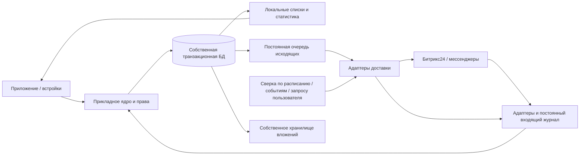

# Переход с Wazzup и автономное ядро приложения

Дата: 2026-10-24. Статус: план для последующей реализации.
Основание: владелец просит сохранить историю/связи при переходе с Wazzup и сделать собственные
данные приложения основой работы. Битрикс24 — основная CRM-интеграция, внешняя по отношению к ядру.
В этой задаче выполнены изучение документации, чтение исходников и агрегатные SELECT.
Подключения, каналы, рабочие данные, схема БД и код приложения не менялись.

## 1. Вывод о переносе открытых линий

**Сохранение LINE_ID не означает сохранение прежнего CHAT_ID и маршрута доставки.**
`imconnector.activate` принимает CONNECTOR и LINE: на уровне API собственный коннектор можно
активировать на указанной линии. Конкретную совместимость с существующей линией проверяем в пилоте.
В `imopenlines.session.open` код диалога содержит коннектор, линию, внешний чат и внешнего пользователя.
Поэтому смена Wazzup на наше подключение не является документированной гарантией продолжения
старого диалога. Это вывод из контрактов API, а не проверенная на рабочем портале миграция.

В изученных методах не найден поддержанный способ передать чужой диалог другому приложению
с гарантией сохранения CHAT_ID. Передача оператору/очереди `imopenlines.operator.transfer`
описывает распределение обращения и сама по себе не подтверждает смену транспорта.
Подмену чужого connector ID и изменение внутренних таблиц Битрикс24 в план не закладываем.

Рекомендуемый результат: прежняя история и связи сохраняются в собственной БД с исходными ID,
а новый маршрут отправки подключается к той же внутренней переписке. В Битрикс24 при необходимости
появляется новый диалог; в приложении обе части истории доступны вместе с отметкой смены канала.
Старый диалог сохраняется как архивная ссылка, пока доступен в Битрикс24.

| Требование | Что можно заложить в проект | Что проверяется до переключения |
|---|---|---|
| Существующая линия, очередь, расписание | Переиспользовать линию либо перенести её настройки | Возможность подключения нашего коннектора к выбранной LINE_ID, боты, права, тариф |
| Тот же старый CHAT_ID Битрикс24 | Не обещать как базовый вариант | Поддержанный сценарий на отдельной тестовой линии; при необходимости ответ поддержки |
| История и связи в приложении | Собственные ID + таблица всех внешних соответствий | Полнота выгрузки и неоднозначные привязки |
| История в прежней карточке CRM | Сохранить старые ID и ссылки; показать активный канал из приложения | Как отключение/удаление Wazzup влияет на старые записи, доступ и вложения |
| Новый диалог в штатном списке чатов нужной сделки | Проверить поддержанное создание связи | Локальный dealId сам по себе не доказывает штатную связь CRM ↔ ОЛ; обязательный пилот |

**Перенос большого массива сообщений не нужен только ради активации нового коннектора.**
Но для независимости от Wazzup и Битрикс24 нужно сохранить историю и файлы у себя. Это отдельная
фоновая загрузка с контрольными точками; её нельзя заменить сохранением одних ссылок на провайдеров.
Тексты и связи можно обрабатывать небольшими страницами, а основное место обычно требуют вложения.
Фактический объём ещё не измерен: число диалогов не даёт числа сообщений и гигабайтов файлов.

## 2. Подтверждённое текущее состояние

Агрегатный SELECT собственного индекса портала от 2026-10-24; это не полная инвентаризация Битрикс24.
`completed = 0` означает состояние локального индекса, а не подтверждённую свежую активность сессии.

| Коннектор Wazzup | Диалогов в индексе | Помечены незавершёнными |
|---|---:|---:|
| WhatsApp | 382 | 237 |
| Telegram | 177 | 141 |
| MAX | 63 | 47 |
| Instagram | 9 | 1 |
| Всего Wazzup | 631 | 426 |

У 509 строк Wazzup поле CRM не равно SQL NULL; это не доказывает наличие, полноту или корректность реальной связи.
Собственный индекс мессенджеров содержит 55 сообщений, из них 12 с вложениями. Это отдельная
переписка наших подключений, не выгрузка истории Wazzup. Сторонний Instagram-коннектор в объём
миграции Wazzup не включён. Telegram/MAX сейчас только учитываются при инвентаризации,
реализация их подключения этой задачей не разрешается.

Аудит кода выявил зависимости, которые нужно устранить для автономности:

- `openlines/ChatsService.history`: история ОЛ читается через REST Битрикс24; `OpenlineChat`
  хранит индекс/сводку, а не всю историю сообщений.
- Настройка собственного коннектора сейчас создаёт новую линию; выбор существующей LINE_ID
  как операции миграции ещё не реализован. Проверка контракта activate не означает готовую функцию UI.
- `crm-mirror`: локальная копия CRM обозначена как восстанавливаемый кэш; часть запросов и прав
  продолжает обращаться к порталу. Это ещё не независимая предметная модель приложения.
- `apps/messenger/src/messages.ts`, `Outbox`: очередь в памяти; перезапуск её теряет,
  переполнение удаляет старые события. Импорт истории не гарантирует восстановление удалений/правок.
- `MessengerInboxService.apply`: ошибка отдельного события логируется, после чего пакет может
  получить успешный HTTP-ответ. Отправитель тогда считает проблемное событие принятым.
- `MessengerConnectorService.firstContact`: внешняя отправка предшествует сохранению результата.
  Сбой между этими шагами оставляет неопределённый исход; повтор может стать второй отправкой.
- Повторы событий оператора ограничены числом попыток/временем. Нужны постоянное состояние задачи
  и очередь разбора ошибок вместо исчезновения операции из обработки.
- В регистрации коннектора используется `CHAT_GROUP: false`. По документации это группировка
  по внешнему пользователю; отдельный `chat.id` не гарантирует отдельный диалог. Разделение
  сделок через virtual chat ID обязательно проверить контрактным пилотом, а не только unit-тестом.

Это задачи будущей реализации, не исправления, выполненные в рамках подготовки плана.

## 3. Целевая архитектура

Приложение владеет своими клиентами, переписками, бронями, правилами, назначениями, журналом и
расчётами статистики. Внешние ID становятся соответствиями, а не первичными ключами бизнеса.
Для каждого поля/факта определяется владелец и правило обмена. Состояние оплаты подтверждает
платёжная система либо разрешённая операция сотрудника; доступность внешнего мессенджера
определяет сам транспорт. Собственная БД не превращает неподтверждённую отправку в доставленную.

Открытие страницы читает собственные данные с отметкой актуальности. Обновление запускает сверку
в фоне и показывает изменения без перезагрузки. Календарь читает актуальные записи собственной
транзакционной БД после переноса владения ресурсом; браузерный кэш не принимает решения о слотах.
До такого переноса действует нынешний режим проверки бронирования через Битрикс24.

### Хранение

Начальный вариант — существующая MariaDB, отдельные предметные таблицы и права служебных
пользователей. Сообщение, его связи и исходящая задача должны фиксироваться одной транзакцией.
Не вводим распределённую транзакцию между несколькими БД без измеренной необходимости.

| Область | Начальная организация | Когда выносить отдельно |
|---|---|---|
| Клиенты, сделки приложения, брони, права, переписки, inbox/outbox | Одна основная транзакционная БД, изолированные модули/таблицы | После замера объёма и нагрузки, с явным протоколом обмена |
| Статистика и поисковые представления | Пересчитываемые таблицы/проекции, фоновые обработчики, курсоры | Отдельный экземпляр БД при конкуренции с рабочими запросами |
| Файлы, аудио, видео, записи звонков | Собственное закрытое объектное хранилище; в БД метаданные и контрольные суммы | Ёмкость/репликация масштабируются независимо |
| Кратковременный кэш | Необязательный ускоритель | Не используется как единственное место очереди/истории |

Несколько баз на одном сервере MariaDB не дают отказоустойчивости к потере этого сервера.
Реплики, резервные копии и независимый узел восстановления решают другую задачу.

### Предметные сущности — проект, не готовая Prisma-схема

- Внутренний tenant, сотрудники/учётные записи, роли, группы и каналы. Tenant живёт независимо
  от установки приложения в конкретный портал; отключение интеграции не удаляет бизнес-данные.
- Клиент и его идентификаторы: телефон, внешний пользователь, WhatsApp PN/LID, аккаунт канала.
  Один номер помогает искать, но не разрешает автоматически сливать разных клиентов.
- Бизнес-переписка/обращение и её связи со сделками/бронями; транспортный поток хранится отдельно.
  Несколько сделок одного клиента не превращаются в несколько независимых WhatsApp-пользователей.
- Сообщение, версии текста, удаление, автор, статусы, вложения, ответы на сообщения.
- Внешние соответствия с уникальностью по tenant + системе + аккаунту + типу + внешнему ID.
  Одна внутренняя переписка может иметь старый Wazzup/Bitrix ID и новый маршрут своего коннектора.
- Сохранённое событие, исходящая операция, попытка доставки, курсор сверки, конфликт, аудит.
  Точные имена моделей и миграции определяются на этапе реализации.

### События и надёжность

1. Сначала надёжно записываем входящее событие, затем подтверждаем его приём. Транспортный
   адаптер тоже имеет постоянную локальную очередь на время недоступности основной БД/API.
2. Применение события и создание следующих задач — одной транзакцией. Потребители идемпотентны;
   события могут повторяться и приходить не по порядку, в том числе удаление раньше сообщения.
3. Принятая команда сотрудника сохраняется до внешней отправки. Статусы различают «в очереди»,
   «принято транспортом», «доставлено», «прочитано», «ошибка» и «исход неизвестен».
4. При таймауте после отправки результат проверяется по внешнему ID/ключу идемпотентности.
   Если провайдер не позволяет это сделать, автоматический повтор неопределённой операции запрещён:
   требуется сверка/разбор. Обещать exactly-once у любого внешнего транспорта нельзя.
5. Изменения отправляются напрямую через адаптер мессенджера из нашей очереди. Битрикс получает
   отражение операции с автором/ID; действия оператора в нашей ОЛ принимаются как внешние команды
   в то же ядро. Сбой CRM не блокирует переписку в приложении при доступном мессенджере.
6. Ошибки не теряются после пяти попыток: сохраняются, повторяются с задержкой либо уходят
   в видимую очередь разбора. Источник/корреляция предотвращают цикл эхо между системами.
7. Сверка идёт по событиям, курсорам изменений и расписанию, с перекрытием границ времени;
   удалённые объекты имеют отметку удаления. Периодическая полная проверка дополняет дельту.
   Пользовательская сверка объединяется с уже идущей задачей, учитывает лимиты и не создаёт шторм.
8. Конфликты разрешаются по владельцу поля, версии и последней общей базе сравнения.
   Время прихода события не является универсальным правилом «последний победил».

### Права и безопасность

- Своя учётная запись/сессия и роли нужны для независимого входа; Битрикс может быть одним из
  способов входа. Нельзя требовать действующий OAuth портала для каждого локального просмотра.
- В миграции сохраняется видимость истории. Собственная политика доступа и её соответствие
  CRM согласуются до переключения: импорт не должен автоматически расширить доступ сотрудников.
- Для операций в Битрикс24 действуют его права. Если часть локальной видимости наследуется из
  CRM, для неё нужен ограниченный срок подтверждения и явно выбранный режим при сбое портала.
  Мгновенный отзыв внешних прав при полностью недоступном портале гарантировать нельзя.
- Tenant определяется по проверенной сессии; проверка на каждом серверном маршруте, в задачах,
  объектах файлового хранилища и внешних соответствиях. Администратор портала не равен межтенантному.
- Webhook аутентифицируется средствами источника, имеет дедупликацию/защиту повторов и лимиты.
  Сервисные ключи, OAuth и браузерные сессии шифруются, VNC имеет отдельную строгую авторизацию.
  Для администрирования/критичных операций предусмотреть MFA и аудит изменения прав.
- Вложения скачиваются в своё хранилище: ограничения размеров, безопасная проверка URL/redirect,
  контрольные суммы, проверка файлов, закрытая выдача и короткие подписанные ссылки.
- Сроки хранения сообщений, правок, удалённых данных, журналов и резервных копий определяются
  отдельно. Резервные копии шифруются; восстановление ключей и файлов проверяется вместе с БД.

### Брони, деньги и остальные модули

Автономность распространяется на весь продукт, а не только переписку. Текущие ADR0003/0007/0013
и проверки календаря продолжают описывать фактический код до поэтапного изменения владения.

Для каждого ресурса вводится один действующий режим записи: прежний `bitrix_primary` либо будущий
`app_primary`. Перед переключением импортируются все занятые будущие интервалы и проверяются
связи с ресурсами/сделками. После переключения окончательное предотвращение пересечений выполняет
транзакция собственной БД: блокировки ресурсов в согласованном порядке и проверка актуальных
интервалов [start,end), UTC. Это должно работать при нескольких worker/API и повторе запроса.

Если онлайн-запись или сотрудники продолжают независимо создавать брони в Битрикс24, при обрыве
связи нельзя одновременно гарантировать отсутствие пересечений в двух системах. До выбора режима
единственного писателя такие внешние брони считаются отдельным незавершённым этапом миграции;
при необходимости используется явный статус «ожидает внешнего подтверждения».

Для клиентов/сделок, товаров, оплат, смен и автоматизаций составляется такая же матрица владения.
Локальные правила и статистика не ждут Битрикс24. Подтверждения оплат и внешние ограничения
сохраняются как полученные факты с происхождением, не выдумываются при недоступности интеграции.

## 4. Порядок перехода

### Этап 0 — инвентаризация и подтверждение ограничений

В будущей реализации собрать все линии, конкретные аккаунты/номера, тип подключения Wazzup
(Маркет/Контакт-центр), WhatsApp/Web/WABA, открытые сессии, очереди, сотрудников, роботов и
ожидающие отправки. Учесть сообщения в ОЛ, iframe Wazzup и комментарии CRM как разные источники.
Сохранить исходные CRM-привязки целиком, а не только последний dealId из текущей сводки.

Проверить доступность экспорта в конкретном кабинете. Официальный `messages_dump` находится
в разделе API для техпартнёров и требует соответствующей авторизации: наличие метода в документации
не доказывает доступность на нашем тарифе/ключе. Альтернативы — поддержанный экспорт Wazzup,
доступная история ОЛ и файлы Битрикс24. Сейчас задачи экспорта и подписки не создавались.

Результат: реестр связей/источников, оценка сообщений/файлов, пропусков и доступа; выбор
«сохраняем LINE_ID» или «новая линия с прежней историей в приложении»; зафиксированное ограничение
по старым CHAT_ID. Если неизменность штатного CHAT_ID обязательна, переход не начинается
до доказанного поддержанного механизма. Сроки зависят от замера и доступности выгрузки.

### Этап 1 — устойчивая основа локальной переписки

Постоянные inbox/outbox, идемпотентные обработчики, неопределённые исходы, внешние соответствия,
собственные вложения, локальное чтение и права, статусы синхронизации. Сначала исправляются
описанные выше ограничения надёжности. Это обязательная предпосылка отказа от Wazzup.

### Этап 2 — начальная загрузка и непрерывная дельта

- До выгрузки начать доступный сбор новых событий, сохранить исходную контрольную точку.
- Загрузить связи и историю страницами с курсорами/манифестом. Файлы сохранять как байты,
  а не только временные URL. Сохранить авторов, время, типы, правки и удаления, где источник их отдаёт.
- Дедуплицировать по проверенным внешним ID. Wazzup UUID, Bitrix message ID и WhatsApp ID могут
  отличаться; одинаковый текст/время дают только кандидата на совпадение, а не основание удалить дубль.
- История загружается в режиме импорта: не отправляется клиентам, не запускает оплату/роботов,
  не создаёт искусственные непрочитанные и не меняет произвольно сделку старых сообщений.
- Сверить количество, диапазоны ID/времени, CRM-связи и контрольные суммы файлов; сохранить список
  недоступных исходных объектов. Уже исчезнувшее у источника не объявлять восстановленным.

### Этап 3 — теневой режим и пилот

Wazzup остаётся единственным разрешённым отправителем выбранного аккаунта; новая интеграция
собирает/сверяет доступные данные без второй отправки. Для испытания сначала отдельный тестовый
канал/линия, затем один согласованный рабочий аккаунт. Тестовые сообщения — только после команды
владельца и с определённым получателем.

Проверки пилота: найденный контакт, несколько сделок, разные каналы, PN/LID, история и вложения,
редактирование/удаление, авторство, native CRM ↔ ОЛ, `CHAT_GROUP`, маршрутизация ответов,
права обычного менеджера, недоступный Битрикс и перезапуск сервиса. Отдельно — один клиент
на двух номерах компании: аккаунты/маршруты не должны сливаться или становиться неоднозначными. Подтверждение очереди не равно
подтверждению доставки. Массовая миграция до прохождения пилота запрещена.

### Этап 4 — управляемое переключение одного аккаунта

1. Зафиксировать T0 и поколение маршрута; временно закрыть новые исходящие этого аккаунта,
   дождаться/разобрать незавершённые старые отправки. Отдельно сверить автоответы и автоматизации.
2. Отключить отправку через выбранное подключение Wazzup поддержанным способом. Только наш флаг
   в БД не остановит чужой сервис: внешний запрет должен быть фактически проверен.
3. Применить последнюю дельту и включить наш маршрут. Один активный отправитель на аккаунт,
   старые задания с прежним поколением не допускаются к отправке.
4. Активировать наш коннектор на проверенной прежней LINE_ID либо на новой линии по результату
   пилота. В приложении связать его с уже существующей внутренней перепиской и прежними сделками.
5. В интерфейсе сделать понятным активный канал. Старый чат Битрикса может технически сохранять
   старый маршрут: если штатный composer нельзя безопасно отключить, сотрудник получает понятный
   переход к активному диалогу/встройке приложения. Не создавать скрытую переотправку из архива.
6. Сверить входящее, исходящее, вложение, сделку, автора и отсутствие двойной отправки.
   Контрольный обмен с реальным получателем требует отдельной команды владельца.

Другие аккаунты переключаются последовательно после периода наблюдения и сверки.
Полное удаление приложения/аккаунта Wazzup не является первым шагом. До него должны быть
подтверждены архив, файлы, сохранность ссылок/связей и условия хранения данных у провайдера.

### Этап 5 — автономность остальных модулей

Переносить по доменам: клиенты/сделки → локальное бронирование ресурсов → товары/платёжные
операции и сроки → смены/статистика/автоматизации. Для каждого домена: владелец полей,
начальная загрузка, теневая сверка, отдельный переход на локальное чтение/запись, критерии отката.
Сохраняются независимые ограничения внешних систем: доставка, банк, внешние права и онлайн-запись.

### Откат

По аккаунту остановить новые отправки, сменить поколение, разобрать неизвестные исходы и только
затем вернуть прежний маршрут, если он сохранён и работоспособен. Не восстанавливать старый снимок
вместо действующей БД: новые сообщения, брони и оплаты должны остаться. Уже доставленное не
отправляется повторно, а неизвестный результат не перекидывается автоматически другому провайдеру.
Возврат старого транспорта не гарантирует автоматического появления новых сообщений в его архиве.

## 5. Отказоустойчивость, производительность, приёмка

Для начала определить измеряемые SLO на реальной нагрузке: время локального чтения, приёма
команды, задержку синхронизации, длину очередей и время восстановления. Предварительная цель
локального чтения первой страницы — p95 до300мс; окончательные цифры после инвентаризации/замера.
Внешняя доставка имеет собственные метрики, её задержка не маскируется скоростью API.

Для событий, подтверждённых нашим API после постоянного сохранения, проверяется отсутствие потери
при перезапуске процесса. ACK внутри стороннего SDK/мессенджера мы не всегда контролируем;
невидимые адаптеру события и уже недоступные данные источника нельзя объявлять гарантированно восстановимыми. Для полной потери узла отдельно согласуются RPO/RTO, размещение реплики
в другом домене отказа и бюджет. Резервная копия плюс binlog позволяют восстановление MariaDB
на момент времени; готовность доказывает регулярное восстановление БД, файлов и ключей.

Критерии допуска к отключению Wazzup:

- Каждая мигрируемая переписка имеет сохранённые исходные идентификаторы и проверенные CRM-связи.
  Все неоднозначные совпадения разрешены либо явно оставлены в очереди решения.
- Полнота выбранного объёма истории и файлов подтверждена манифестом; исключения видны и согласованы.
  Нельзя обещать восстановить то, что источники уже не отдают.
- Импорт/сверка/повтор события не создают исходящие клиентам, новые сделки или повторные оплаты.
- Убийство процесса до/после сохранения, таймаут после отправки, дубли и смена порядка событий
  пройдены тестами. На границе T0 нет неконтролируемой двойной отправки через два провайдера.
- Отключение Битрикс24 не блокирует вход в приложение, собственную историю, очереди и локальные
  операции уже переведённых доменов. Неподтверждённые внешние действия видны как ожидающие.
- Права проверены минимум на администраторе, двух разных группах и пользователе без доступа;
  отдельно проверены изоляция tenant и отзыв прав.
- Брони защищены от пересечений локальной транзакцией после явного перехода ресурса на app_primary.
- В Битрикс24 проверен реальный пользовательский путь к активному диалогу из нужной сделки.
  Новый CHAT_ID и старый архивный CHAT_ID отражены явно, если сохранение ID не поддержано.
- Проведён откат маршрута без потери новой истории, затем проверено восстановление из бэкапа.

### Звонки

Владелец допускает прекращение работы звонков, связанных с Wazzup. Это не разрешение отключать
обычную телефонию Битрикс24/Voximplant или другие номера. На инвентаризации разделить настоящие
звонки, уведомления о пропущенных в WhatsApp и системные сообщения в чатах. Их исторические записи
и доступные файлы сохраняются отдельно; поддержку новых звонков нашим транспортом не обещаем.
WhatsApp Web-адаптер не становится надёжнее самого внешнего протокола: постоянные очереди сохраняют
наши данные, но не гарантируют доступность аккаунта или неизменность WhatsApp Web.

## 6. Открытые проверки перед реализацией

1. Какой именно вариант подключения и тариф Wazzup у каждого аккаунта; есть ли доступ к архивному
   экспорту и медиаданным. Данные старого коннектора нельзя считать полностью отражёнными в ОЛ.
2. Поддерживается ли сохранение штатного CHAT_ID при смене коннектора; если нет — принимается
   ли новый CHAT_ID с единой историей в приложении. Это ограничение платформы, не объём миграции.
3. Как штатно связать новый диалог с прежней CRM-сделкой на этом портале; наличие локального
   соответствия отдельно не подтверждает работу кнопки чатов в стандартной карточке Битрикса.
4. Требуемая глубина архива, сроки хранения, режим видимости при недоступности CRM, RPO/RTO.
5. Какие внешние точки записи брони останутся и как обеспечить единственного писателя ресурса.
6. Какие автоответы/отправки Wazzup нужно отключить или заменить алгоритмами приложения.

Эти вопросы включены в будущую инвентаризацию и пилот. Они не требуют изменения рабочего
подключения сейчас. Реализация, создание БД, экспортные задания, сообщения и переключение
интеграций начнутся только после отдельной команды владельца.

## Источники и связанные решения

REST Битрикс24 проверен через официальный MCP `bitrix24-docs` 2026-10-24:

- [Активация коннектора на линии](https://apidocs.bitrix24.com/api-reference/imopenlines/imconnector/imconnector-activate.html).
- [Код существующего диалога](https://apidocs.bitrix24.com/api-reference/imopenlines/openlines/sessions/imopenlines-session-open.html).
- [Регистрация коннектора и CHAT_GROUP](https://apidocs.bitrix24.com/api-reference/imopenlines/imconnector/imconnector-register.html).
- [Передача оператору/очереди](https://apidocs.bitrix24.com/api-reference/imopenlines/openlines/operators/imopenlines-operator-transfer.html).
- [Чтение истории страницами](https://apidocs.bitrix24.com/api-reference/chats/messages/im-dialog-messages-get.html).
- [Чаты CRM-объекта](https://apidocs.bitrix24.com/api-reference/imopenlines/openlines/chats/imopenlines-crm-chat-get.html).
- [Wazzup: экспорт сообщений, API для техпартнёров](https://wazzup24.ru/help/api/messages/).
- [Wazzup: варианты интеграции](https://wazzup24.ru/help/bitrix24/integration-differences/).
- [Wazzup: собственные чаты и ОЛ](https://wazzup24.ru/help/bitrix24/chto-takoe-otkrytye-linii-i-kak-imi-polzovatsya/).
- [Wazzup: уведомления о звонках WhatsApp](https://wazzup24.ru/help/how-to-use/missed-call-ru/).
- [MariaDB: восстановление на момент времени](https://mariadb.com/docs/server/server-usage/backup-and-restore/mariadb-backup/point-in-time-recovery-pitr-mariadb-backup).
- [whatsapp-web.js: свойства и ограничения адаптера](https://docs.wwebjs.dev/index.html).

Направление архитектуры: [ADR0016](../decisions/0016-autonomous-application-core.md).
Предыдущие решения: ADR0003/0007/0013/0014/0015 описывают действующий код до соответствующего этапа.
